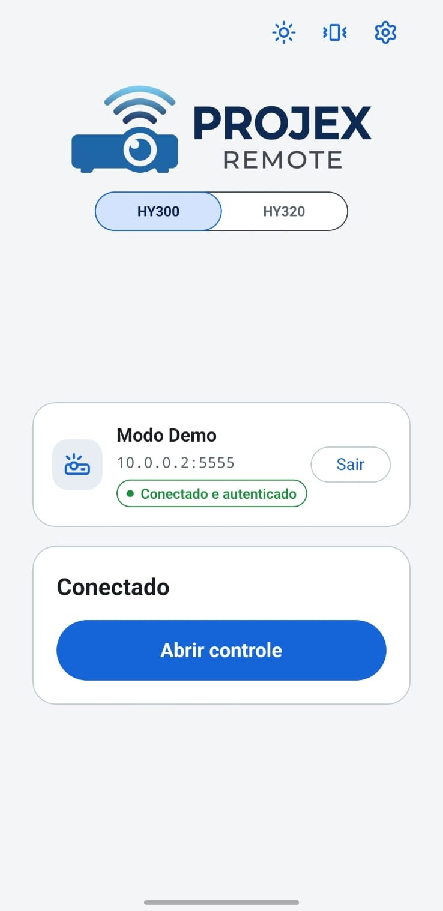
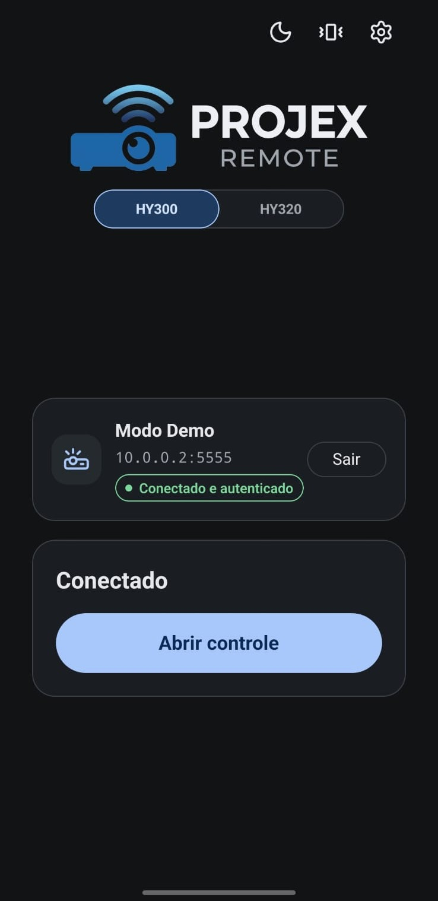
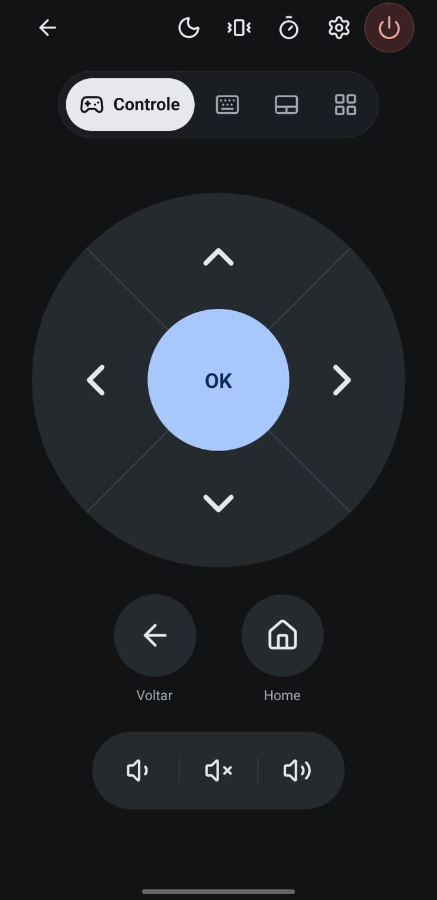
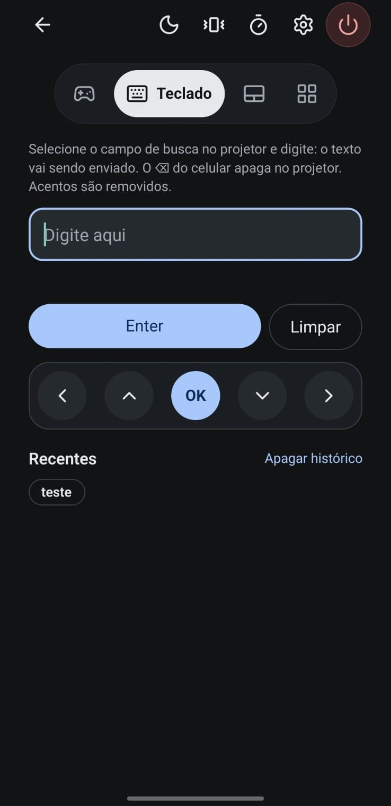
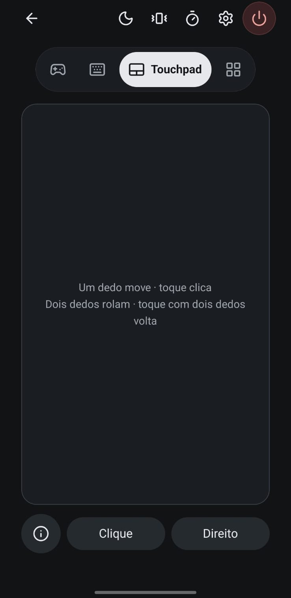
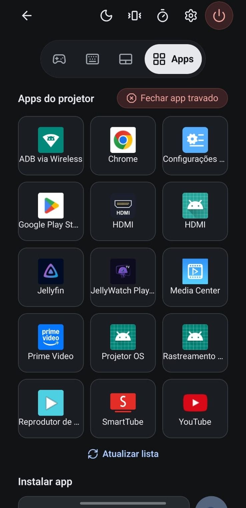

# Projex Remote (HY300)

App Android (Expo + React Native) que controla o projetor HY300 (e HY320) pela rede local via ADB sobre TCP.

## Capturas

| Início (claro) | Início (escuro) | Controle |
| :---: | :---: | :---: |
|  |  |  |
| **Teclado** | **Touchpad** | **Apps** |
|  |  |  |

## Funcionalidades

- **Conexão:** IP e porta (5555) do projetor, salvos ao conectar; modo demonstração com projetor simulado; seletor de modelo HY300 / HY320.
- **Barra do controle:** voltar ao início; tema claro/escuro; vibrar/silencioso; temporizador; configurações; desligar (com confirmação, e o app confirma o "desligar?" do projetor).
- **Controle:** direcional com OK (segurar repete), Voltar, Home, Volume −, Mudo e Volume +.
- **Teclado:** o texto digitado no celular vai sendo enviado; o ⌫ do celular apaga no projetor (mesmo com o campo vazio); Enter, Limpar, atalhos ◀ ▲ OK ▼ ▶ e histórico de textos.
- **Touchpad:** cursor de mouse no projetor. Um dedo move (com aceleração), toque clica, dois dedos rolam, toque com dois dedos é o clique direito (Voltar); botões Clique e Direito; tutorial animado na primeira vez e no botão (i).
- **Apps:** lista dos apps instalados com nome e ícone (carrega ao conectar e ao abrir a aba vazia), abrir app, fechar app travado e buscar na Play Store do projetor.
- **Temporizador:** 15 a 120 min, rodando no próprio projetor (funciona com o celular desligado), com contagem, horário de início e de desligamento.
- **Configurações e Diagnóstico:** tema, vibração, estado da conexão, latência, modelo/API, privilégio do shell, como as teclas são enviadas e gerar nova chave ADB.

## Estrutura

- `src/app` — telas (expo-router): Conexão (`index`), Controle (`remote`: abas Controle / Teclado / Touchpad / Apps) e Configurações e Diagnóstico (`diagnostics`). UI com `react-native-ui-lib` e ícones Lucide; tokens de cor, raio e espaçamento em `src/theme`.
- `src/services/adb` — máquina de estados, fila serial, reconexão, heartbeat, construção segura de comandos e transporte simulado.
- `modules/adb-bridge` — módulo nativo Kotlin sobre o [dadb](https://github.com/mobile-dev-inc/dadb) (Apache-2.0). A chave ADB é gerada no módulo e guardada cifrada com AES-GCM do Android Keystore.
- `tools/projector-helper` — classes Java que rodam no projetor (`app_process`): `AppLister` (apps com nome e ícone) e `Paste` (digita colando, porque o firmware transforma a tecla "a" no aviso do controle de voz). `build.sh` gera `src/services/adb/helperDex.ts`; rode de novo se editar um `.java`.
- `tests` — testes Jest (validação, comandos e cliente com transporte simulado).

## Comandos

```sh
npm install
npm test
npx tsc --noEmit
npx expo lint
npx expo run:android --device   # precisa de build nativo (módulo adb-bridge)
```

## Decisões

- **Teclas por evdev em vez de `input keyevent`:** `input keyevent` leva ~1,2 s por tecla no HY300 (sobe uma JVM a cada chamada). Escrever `struct input_event` em `/dev/input/event0` (receptor IR) leva ~10–40 ms. Sem o nó IR gravável, tudo cai para `input keyevent`.
- **Mudo:** `KEYCODE_VOLUME_MUTE` (164); `KEYCODE_MUTE` (91) é o mudo do microfone.
- **Texto:** `input text` (~1,2 s por chamada), só ASCII imprimível; acentos são removidos. No HY300, textos com "a" são colados pelo helper `Paste`, porque a tecla A abre o aviso do controle de voz; o HY320 digita normalmente.
- **Touchpad:** o Android 9 só mostra a seta com um mouse conectado, então o app registra um mouse USB virtual com o comando `hid` do próprio sistema (`/dev/uhid`; o shell do ADB está no grupo `uhid`, sem root). Os relatórios vão por um FIFO; os movimentos são acumulados e enviados em lotes. O mouse existe só enquanto a aba Touchpad está aberta.

## Segurança

Na investigação inicial, o HY300 estava com `ro.adb.secure=0` e shell root para qualquer aparelho da mesma rede Wi-Fi. No aparelho conferido em 30/10/2026, estava com `ro.adb.secure=1` e o shell como usuário `shell` (uid 2000, sem root): o firmware pode variar, então trate o ADB por rede como acesso amplo ao projetor. O app só aceita endereços de rede local (10.x, 172.16–31.x, 192.168.x, 169.254.x e 127.x). Não exponha a porta 5555 à internet.

## Pendências conhecidas

- Cancelar durante a negociação: a thread nativa só termina no timeout (20 s).
